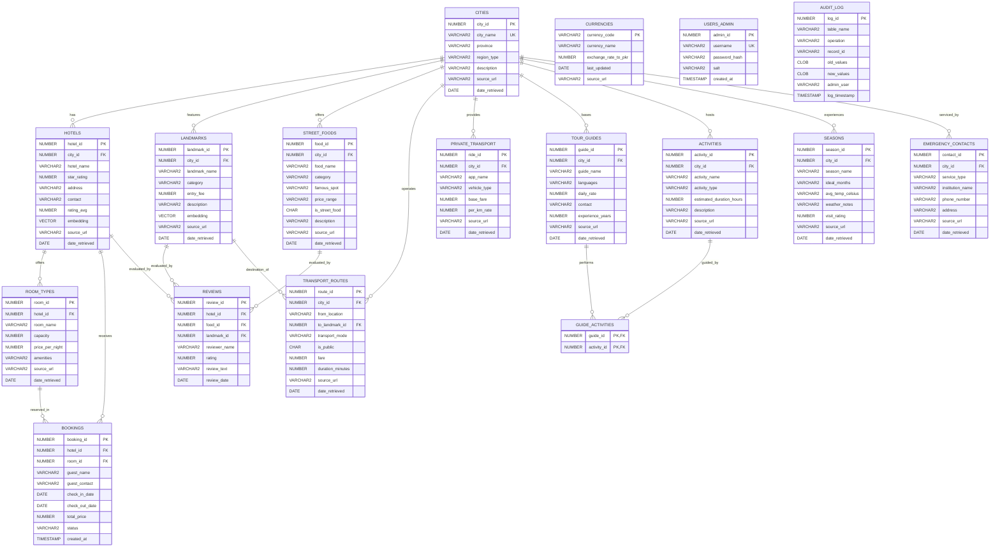

# Entity Relationship (ER) Diagram: Explore Pakistan

The database schema is designed in strict **Third Normal Form (3NF)** with clear primary/foreign key cardinalities and integrity constraints.

---

## Relational Characteristics

1. **Strict 3NF Compliance**: Non-key attributes are transitively independent of the primary keys.
2. **Referential Integrity**: Cascading deletes (`ON DELETE CASCADE`) maintain orphan-free children tables.
3. **Polymorphic Safety**: The `reviews` table utilizes dedicated nullable foreign key columns with a mutually exclusive `CHECK` constraint:
   $$	ext{CHECK }((	ext{hotel\_id IS NOT NULL}) + (	ext{food\_id IS NOT NULL}) + (	ext{landmark\_id IS NOT NULL}) = 1)$$
   This maintains native Oracle foreign key indexability and referential integrity without generic untyped ID pointers.
4. **Automated Auditability**: Every administrative mutation is tracked in `audit_log` through row-level triggers.
